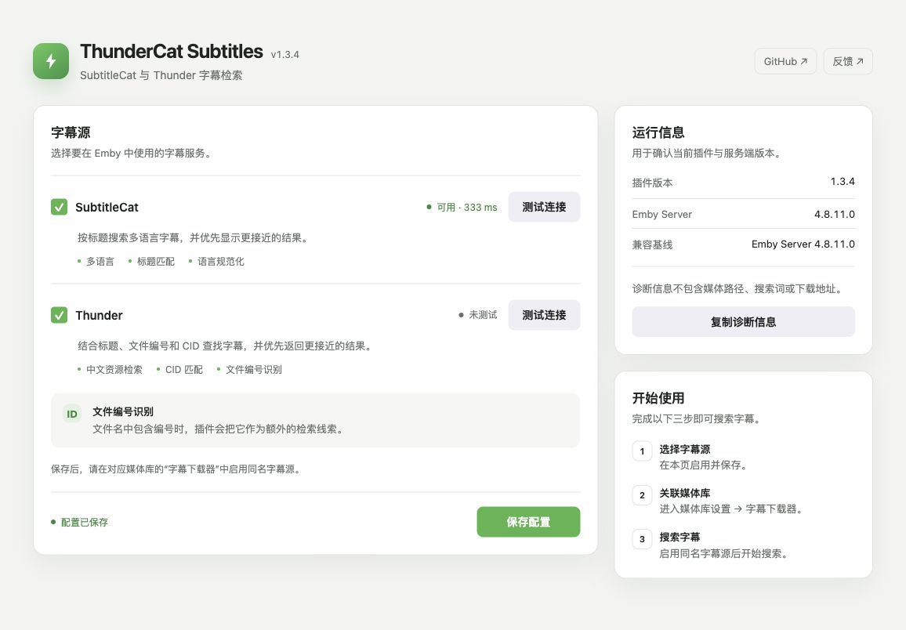

# ThunderCat Subtitles for Emby

English | [中文](./README_CN.md)

ThunderCat connects Emby to **SubtitleCat** and **Thunder (Xunlei)** for subtitle search and download.

It supports multilingual search, title matching, language normalization, file-ID extraction, and CID matching against local files.

> ThunderCat does not host media files or subtitles. Search results and subtitle files are supplied by third-party services.



## Features

- Search multilingual subtitles through SubtitleCat and rank results by title similarity.
- Search Thunder and improve matching with local-file CID data.
- Classify high-confidence results with compact `[CID]`, `[ID]`, and `[TITLE]` labels.
- Remove exact duplicate results within each provider before they reach Emby.
- Prioritize Thunder results that explicitly match the requested language.
- Fall back from release/catalog identifiers to the original title when needed.
- Cache repeated searches briefly in memory without persisting media queries.
- Use release or catalog identifiers from media filenames even when Emby supplies a display title.
- Normalize common Chinese, English, Japanese, Korean, and other language metadata.
- Support `srt`, `ass`, `ssa`, and `vtt` subtitle formats.
- Enable SubtitleCat and Thunder independently.
- Test provider connectivity and copy privacy-safe diagnostics from the configuration page.

## Security design

- Short-lived opaque download tokens avoid exposing upstream URLs in subtitle IDs.
- Requests are restricted to HTTPS, explicit host allowlists, port 443, and public IP addresses.
- Redirect targets are revalidated on every hop to reduce SSRF risk.
- Network requests use per-attempt timeouts, bounded retries, provider-level search budgets, and response-size limits.
- Downloaded content is checked to reject HTML/JSON error pages and disguised archives.
- Diagnostics exclude media paths, search queries, and download URLs.

## Compatibility

| Item | Status |
|---|---|
| Target framework | `netstandard2.0` |
| Release SDK baseline | `MediaBrowser.Server.Core 4.8.11` |
| Emby Server 4.8.11.0 | Plugin loading verified; SDK build and tests pass |
| Emby 4.9.x | SDK build and tests pass; real-server validation is still recommended |
| Emby 4.10 Beta | Beta SDK build/test check only; not a stable compatibility claim |

Releases are built as a single DLL against the minimum supported SDK. Automated tests demonstrate source compatibility but do not replace real-server search, download, cancellation, and soak testing.

## Installation

1. Download the matching ZIP from Releases.
2. Extract `Emby.Subtitle.ThunderCat.dll` into Emby's `plugins` directory.
3. Restart Emby Server.
4. Open **Plugins → ThunderCat Subtitles**, enable the providers you want, and save.
5. Open **Library settings → Subtitle Downloads** and enable SubtitleCat and/or Thunder.

Common plugin directories:

- Linux / Docker: `/var/lib/emby/plugins`
- Windows: `%AppData%\Emby-Server\programdata\plugins`

## Configuration page

The configuration page provides:

- Global switches for SubtitleCat and Thunder.
- Saved/unsaved state feedback.
- Server-side connectivity tests for both providers.
- Plugin version, Emby Server version, and compatibility baseline.
- A diagnostic summary that excludes sensitive media information.

Connectivity tests run on Emby Server and reuse the plugin's HTTPS, host-allowlist, and public-address validation. A successful test confirms that the upstream is currently reachable; it does not guarantee subtitles for a particular title.

## FAQ

### Does it support filenames with release or catalog identifiers?

Yes. When a filename contains a letter-and-number identifier, ThunderCat can use it as an additional search hint.

### Why must a provider be enabled in two places?

The plugin page controls the global provider switch. Emby's library subtitle-download settings decide whether a particular library uses that provider. Both must be enabled for the provider to participate in searches.

### Connectivity succeeds, but why are there no results?

The connectivity test only confirms that the upstream can be reached. Results still depend on the title, identifier, requested language, upstream inventory, and upstream protocol compatibility.

## Build and test

The full solution test suite uses .NET SDK 10:

```bash
dotnet restore Emby.Subtitle.ThunderCat.sln
dotnet test Emby.Subtitle.ThunderCat.sln -c Release
```

Build the release DLL against the Emby 4.8.11 SDK baseline:

```bash
dotnet build Emby.Subtitle.ThunderCat.csproj \
  -c Release \
  -p:EmbySdkVersion=4.8.11
```

Output:

```text
bin/Release/netstandard2.0/Emby.Subtitle.ThunderCat.dll
```

## Known boundaries

- SubtitleCat and Thunder are third-party upstreams whose contracts and availability may change.
- Upstream domain migrations require a security review before allowlists are updated.
- DNS validation reduces SSRF risk, but production deployments should still enforce host/container egress policies.
- The project cannot guarantee subtitle availability and does not bypass upstream access restrictions.

## License

MIT License © 2026 drunkleee
