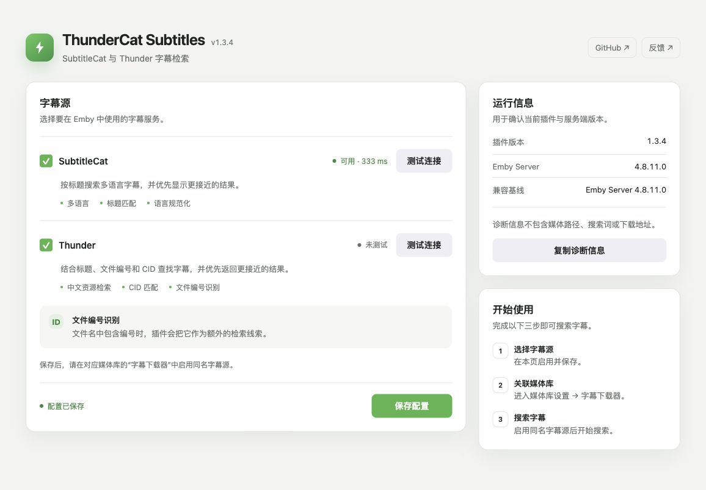

# ThunderCat Subtitles for Emby

[English](./README.md) | 中文

ThunderCat 是一个面向 Emby 的字幕检索插件，集成 **SubtitleCat** 与 **Thunder（迅雷）** 字幕源。

它支持多语言检索、标题匹配、语言规范化、文件编号识别和本地文件 CID 匹配。

> ThunderCat 不托管媒体文件或字幕。搜索结果和字幕文件由第三方服务提供。



## 功能

- 通过 SubtitleCat 搜索多语言字幕，并按标题相似度排序。
- 通过 Thunder 搜索字幕，并结合本地文件 CID 改进匹配。
- 使用简洁的 `[CID]`、`[ID]` 和 `[TITLE]` 标识高置信度结果。
- 在结果进入 Emby 前移除字幕源内部的精确重复项。
- 优先展示明确符合请求语言的 Thunder 结果。
- 编号检索没有可靠结果时，自动回退到原始标题。
- 仅在内存中短暂缓存重复搜索，不持久化媒体查询。
- 即使 Emby 已提供显示标题，也会从媒体文件名提取发行编号或目录编号。
- 规范化中文、英文、日文、韩文等常用语言元数据。
- 支持 `srt`、`ass`、`ssa`、`vtt` 字幕格式。
- 可独立启用或关闭 SubtitleCat 与 Thunder。
- 配置页支持连接测试、运行信息和安全诊断信息复制。

## 安全设计

- 使用短期、不可猜测的下载令牌，不在字幕 ID 中暴露原始下载地址。
- 仅访问 HTTPS、明确允许的域名、443 端口和公网地址。
- 每次跳转都会重新校验目标地址，降低 SSRF 风险。
- 网络请求具有单次尝试超时、有限重试、字幕源搜索总时限和响应大小限制。
- 下载内容会经过格式检查，拒绝 HTML、JSON 错误页和压缩包伪装。
- 诊断信息不会包含媒体路径、搜索关键词或下载地址。

## 兼容性

| 项目 | 状态 |
|---|---|
| 目标框架 | `netstandard2.0` |
| Release 构建基线 | `MediaBrowser.Server.Core 4.8.11` |
| Emby Server 4.8.11.0 | 已验证插件加载；SDK 构建与测试通过 |
| Emby 4.9.x | SDK 构建与测试通过，仍建议真实环境验证 |
| Emby 4.10 Beta | Beta SDK 构建与测试检查，不视为稳定兼容认证 |

Release 使用最低支持 SDK 构建单一 DLL。自动化测试可以证明源码兼容，但不能替代真实 Emby 环境中的搜索、下载和长期运行验证。

## 安装

1. 从 Releases 下载对应版本的 ZIP。
2. 解压并将 `Emby.Subtitle.ThunderCat.dll` 放入 Emby 的 `plugins` 目录。
3. 重启 Emby Server。
4. 打开 **插件 → ThunderCat Subtitles**，启用需要的字幕源并保存。
5. 前往 **媒体库设置 → 字幕下载器**，勾选 SubtitleCat 和/或 Thunder。

常见插件目录：

- Linux / Docker：`/var/lib/emby/plugins`
- Windows：`%AppData%\Emby-Server\programdata\plugins`

## 配置页

配置页包含：

- SubtitleCat 与 Thunder 全局开关；
- 保存状态和未保存更改提示；
- 两个字幕源的服务端连接测试；
- 插件版本、Emby Server 版本和兼容基线；
- 不包含敏感媒体信息的诊断摘要。

连接测试由 Emby Server 发起，并复用插件现有的域名白名单、HTTPS 和公网地址校验。它只用于判断上游当前是否可以访问，不代表某个具体标题一定有字幕结果。

## 常见问题

### 是否支持带有发行编号或目录编号的文件名？

支持。文件名包含字母和数字组成的编号时，ThunderCat 会将它作为额外的检索线索。

### 为什么插件配置页已经启用，字幕下载器里还需要再勾选？

插件配置页控制全局开关；Emby 媒体库中的字幕下载器设置控制具体媒体库是否使用该 Provider。两处都启用后才会参与字幕搜索。

### 连接测试成功，为什么仍然没有字幕？

连接测试只确认上游服务可访问。搜索结果仍取决于媒体标题、编号、语言、上游库存以及上游协议是否发生变化。

## 构建与测试

完整解决方案测试使用 .NET SDK 10：

```bash
dotnet restore Emby.Subtitle.ThunderCat.sln
dotnet test Emby.Subtitle.ThunderCat.sln -c Release
```

使用 Emby 4.8.11 SDK 构建发布 DLL：

```bash
dotnet build Emby.Subtitle.ThunderCat.csproj \
  -c Release \
  -p:EmbySdkVersion=4.8.11
```

编译产物：

```text
bin/Release/netstandard2.0/Emby.Subtitle.ThunderCat.dll
```

## 已知边界

- SubtitleCat 与 Thunder 都是第三方上游，接口和可用性可能随时变化。
- 上游迁移域名时，需要经过安全审查后更新域名白名单。
- DNS 校验能够降低 SSRF 风险，但生产环境仍建议配置主机或容器出站网络策略。
- 本项目不保证所有媒体都能检索到字幕，也不会绕过上游访问限制。

## 许可证

MIT License © 2026 drunkleee
